<p align="center">
  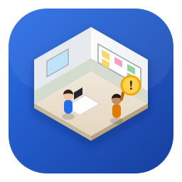
</p>

<h1 align="center">AgentMissionFloor</h1>

<p align="center">
  <b>Watch your AI agents work, live, in a 3D office.</b>
</p>

<p align="center">
  <a href="https://nodejs.org"></a>
  <a href="https://www.typescriptlang.org"></a>
  <a href="https://threejs.org"></a>
  <a href="https://code.claude.com/docs"></a>
  
  
  <a href="LICENSE"></a>
</p>

<p align="center">
  A live, local-only isometric office where your Claude Code sessions are a team at work.<br>
  See who's working on what, who's idle, who's running out of memory, and who needs you, at a glance from across the room.
</p>

<p align="center">
  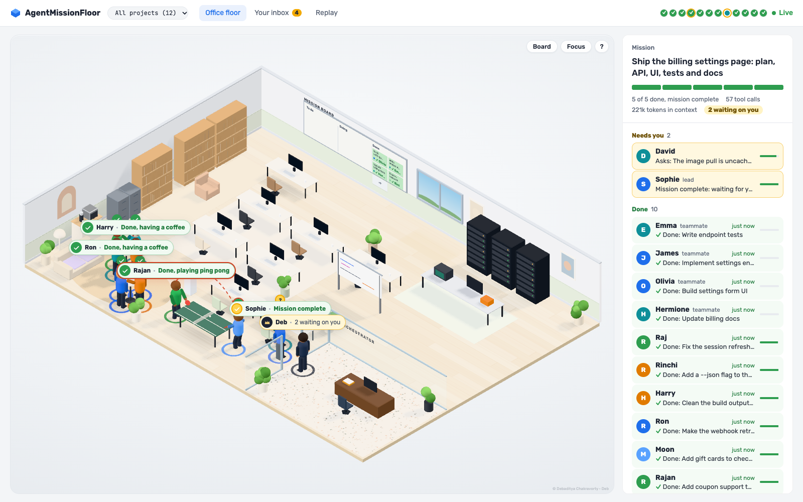
</p>

---

## Contents

- [What is it?](#what-is-it)
- [What it can do](#what-it-can-do)
- [Screenshots](#screenshots)
- [Quick start (step by step)](#quick-start-step-by-step)
- [Stop and exit cleanly](#stop-and-exit-cleanly)
- [Using the board](#using-the-board)
- [How it's built (architecture)](#how-its-built-architecture)
- [Security and privacy by design](#security-and-privacy-by-design)
- [Configuration](#configuration) · [Troubleshooting](#troubleshooting) · [Project layout](#project-layout) · [Roadmap](#roadmap)

## What is it?

AgentMissionFloor turns every Claude Code session into a **person in an isometric office**. Keep it open on a second monitor and you can read the state of your work at a glance:

- **Where** each agent is tells you **what kind of work** they're doing: at a desk they're editing code, at the library they're reading and searching, in the test lab they're running tests.
- **Their label** says what they're doing in plain words ("Editing session.ts +42 −9") and what they were asked to do. A green ✓ means their work is **done**.
- **The mission board** on the wall holds the team's tasks: *To do → Doing → Done*, with who finished what. Press **B** to read it full size.
- **When an agent needs you** (a permission prompt or a question), they walk to the **AI Orchestrator's** glass office, and **Deb** comes to the door to listen.
- **Idle agents** have coffee and a chat in the café, and two of them play ping pong.

It's local-only, private by default, and adds **zero tokens** to your Claude usage.

## What it can do

| | |
|---|---|
| 🏢 **Live office** | Each session, teammate and subagent is a person who walks between stations as their work changes. |
| ✅ **Finished work** | Done people get a green ✓ ("Done, having a coffee"), the board's *Done* column says who finished each task, and a toast tells you when someone finishes. |
| 🗂️ **Mission board** | Tasks pop onto the board, get carried by whoever claims them and pin to *Done*. Interns' and teammates' assignments get cards too. Open it full size with **B**. |
| 🙋 **Your inbox** | Approvals (with the exact command), questions, mission-complete summaries and file conflicts. Desktop notifications and an unread count in the tab title. |
| 👥 **Team panel** | Grouped by what matters: **Needs you**, **Working**, **Done**, **Idle**, with a segmented mission bar (one segment per task). |
| ⏰ **While you were away** | Come back after a while and one card tells you what finished, who waited for you and what failed, with a one-click replay. |
| 🗃️ **Project filter** | Several repos at once? Show one project's people, board and mission. |
| 🔍 **Person close-up** | Model, memory left, exact token usage, files touched, recent moves and latest terminal output. Follow them with the camera. |
| ⚠️ **Conflict alerts** | Two agents edit the same file within two minutes: a red arc between them and an inbox card with both changes. |
| ⏪ **Replay** | Play back today at 1×–60× with footprint trails, lanes per person, key moments, a debrief, a 30-second highlight reel and **WebM clip export**. |
| 🖥️ **Focus mode** | **F** shows only the office: made for a wall or a second screen. |

## Screenshots

<table>
  <tr>
    <td width="50%">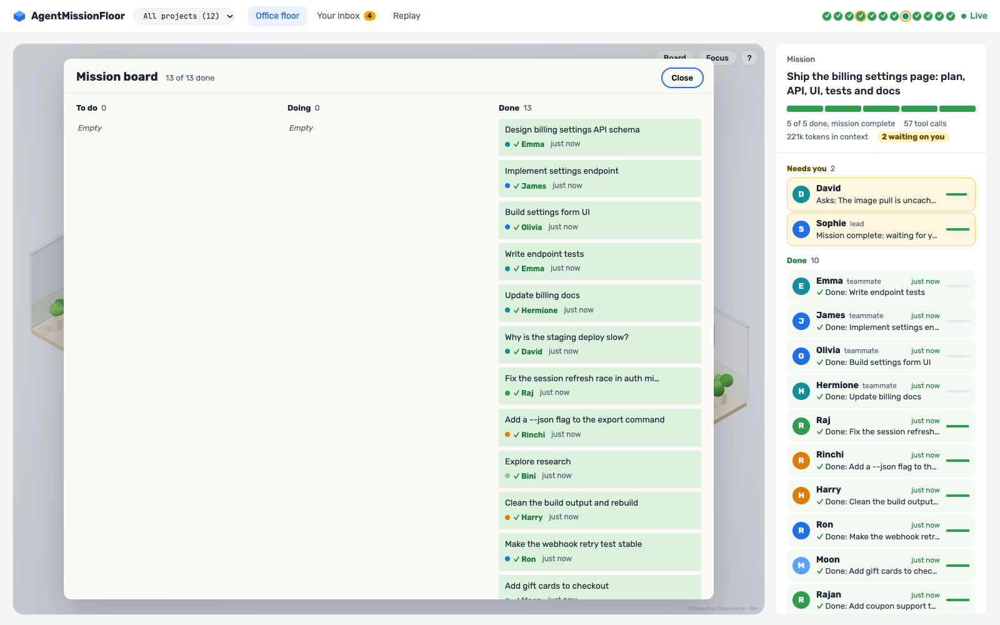<br><b>Mission board (B):</b> every task, who finished it and when.</td>
    <td width="50%">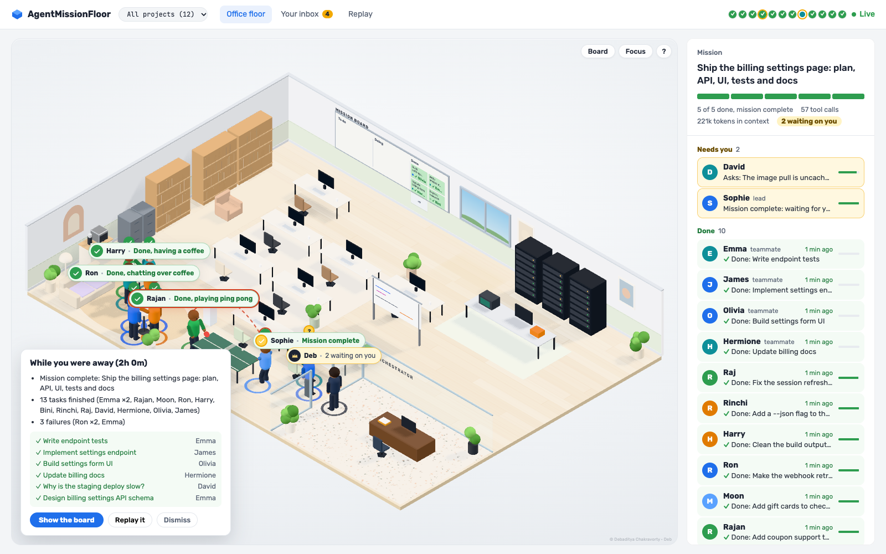<br><b>While you were away:</b> what happened since you last looked.</td>
  </tr>
  <tr>
    <td width="50%">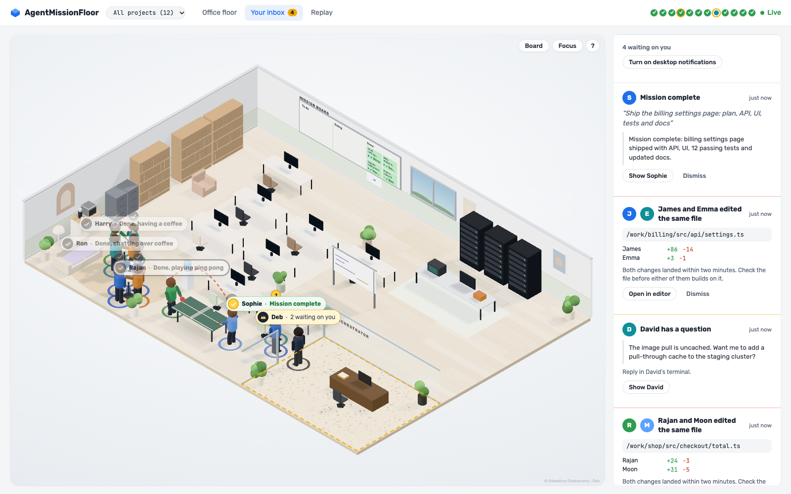<br><b>Your inbox:</b> everyone who doesn't need you fades back.</td>
    <td width="50%">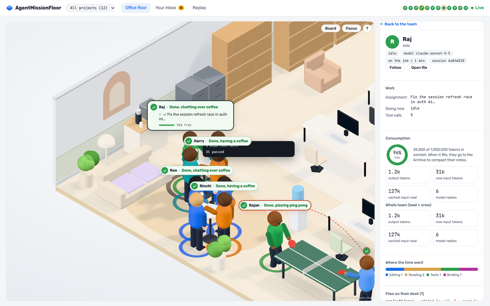<br><b>Close-up:</b> model, memory left, tokens used, files touched.</td>
  </tr>
  <tr>
    <td width="50%">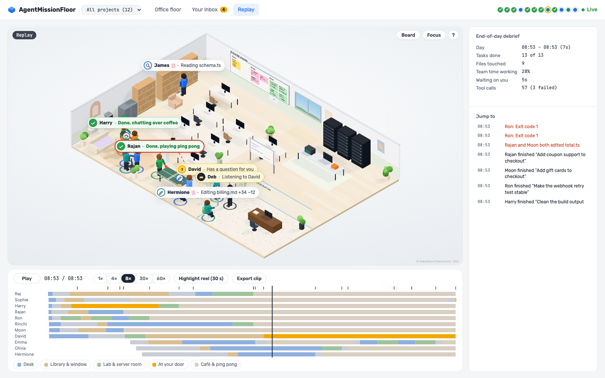<br><b>Replay:</b> lanes per person, key moments and a highlight reel.</td>
    <td width="50%">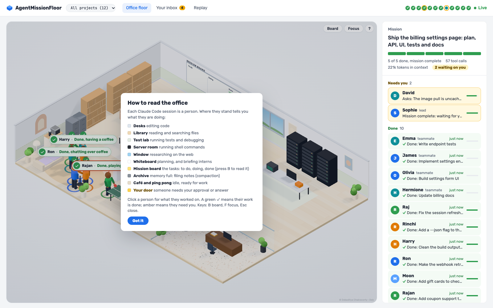<br><b>How to read the office:</b> shown once, then on <kbd>?</kbd>.</td>
  </tr>
</table>

## Quick start (step by step)

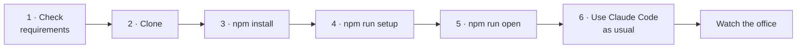

**Step 1: check the requirements.**

| You need | Check with |
|---|---|
| macOS or Linux (Windows is planned) | |
| Node.js 22.18 or newer | `node --version` |
| Claude Code with plugin support | `claude --version` |
| `curl` (already on macOS and most Linux) | `curl --version` |
| A modern browser: Chrome, Edge, Safari or Firefox | |

**Step 2: get the code.**

```sh
git clone https://github.com/debaditc/AgentMissionFloor.git
cd AgentMissionFloor
```

**Step 3: install.** This installs the dependencies and builds the 3D office.

```sh
npm install
```

**Step 4: connect it to Claude Code.**

```sh
npm run setup
```

`setup` registers this folder as a local plugin marketplace, installs the plugin with Claude Code's own `claude plugin` commands, and then runs a health check. You should see a list ending in **All good.** If anything shows ✗, the line under it says how to fix it.

**Step 5: open the board.**

```sh
npm run open
```

It starts the collector if needed and opens the board with a one-time sign-in link. **Bookmark the page**: the address stays the same and your browser stays signed in for a year. The first visit shows a short *How to read the office* card.

**Step 6: use Claude Code as usual.**

```sh
claude
```

Every new session walks into the office. Subagents appear as interns beside whoever briefed them.

**Optional: try an agent team.**

```sh
CLAUDE_CODE_EXPERIMENTAL_AGENT_TEAMS=1 claude
```

Then ask, for example: *"Create a task list of 5 small tasks for this repo and have 3 teammates work through them."* Cards flow across the mission board as the team works.

**No Claude session handy?** `npm run demo` opens a throwaway office with a simulated team. Ctrl+C deletes it, and your real data is never touched. You can also play scenarios into your own board:

```sh
npm run sim -- team solo permission conflict flaky compaction --speed 2
```

| Scenario | What you'll see |
|---|---|
| `team` | A lead and four teammates working through five tasks with dependencies |
| `solo` | Three independent sessions, one briefing an intern |
| `permission` | An agent waiting at your door for approval |
| `conflict` | Two agents editing the same file |
| `flaky` | A test that fails twice, then passes |
| `compaction` | Memory filling up and a trip to the Archive |

**Keep it up to date.** After `git pull`, run `npm install && npm run setup`, then `npm run stop && npm run open`.

**Remove it.**

```sh
npm run uninstall                # removes the plugin and stops the collector (your history is kept)
npm run uninstall -- --purge     # …and deletes your local history too
```

## Stop and exit cleanly

Closing the browser tab doesn't stop anything: the collector keeps running quietly in the background (it uses almost no resources). To shut it down:

```sh
npm run stop        # stops the collector cleanly (saves and closes the database)
npm run status      # confirms: "The collector is not running."
```

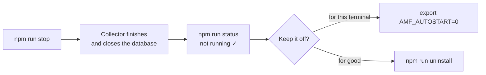

**It comes back with your next Claude Code session.** The plugin starts the collector when a session begins. To keep it off:

| You want | Do this |
|---|---|
| Stop it now | `npm run stop` |
| Don't start it again from this terminal | `export AMF_AUTOSTART=0` (sessions still record, nothing starts) |
| Stop recording too, for this terminal | `export AMF_DISABLED=1` (hooks exit instantly and send nothing) |
| Remove it from Claude Code | `npm run uninstall` (stops the collector and removes the plugin) |
| Remove it and delete all its data | `npm run uninstall -- --purge` |
| Stop the demo | Press <kbd>Ctrl</kbd>+<kbd>C</kbd> in the terminal running `npm run demo` (its data is deleted) |
| Stop a collector started with `npm run collector` | Press <kbd>Ctrl</kbd>+<kbd>C</kbd> in that terminal |

**If it won't stop** (rare; for example after a crash), stop the process directly:

```sh
# macOS and Linux: find it…
pgrep -fl "collector/src/main.ts"
# …and stop it (SIGTERM lets it close the database cleanly)
pkill -f "collector/src/main.ts"
# check that nothing is left
pgrep -fl "collector/src/main.ts" || echo "stopped"
```

Use `pkill -9 -f "collector/src/main.ts"` only if the plain `pkill` doesn't work within a few seconds. The next start tidies up automatically.

## Using the board

**Views (tabs at the top):** *Office floor* · *Your inbox* · *Replay*. A plain event log is linked at the bottom of the side panel.

**The side panel** puts what matters first: **Needs you** (amber), **Working**, **Done** (green ✓, newest first) and **Idle** (collapsed). The dots in the header are everyone in the office: amber needs you, green ✓ is done. Click one to open that person.

| Action | How |
|---|---|
| Zoom, pan, reset | Scroll · drag · double-click |
| Read the mission board | Click the board on the wall, the mission bar, or press <kbd>B</kbd> |
| What a place means | Hover the floor, or press <kbd>?</kbd> for *How to read the office* |
| Focus mode (just the office) | <kbd>F</kbd>, or *Focus* in the scene's corner |
| One project only | The project menu in the header (appears when several projects are active) |
| Open someone's details | Click the person, their label, their dot or their row in the team panel |
| Follow someone | *Follow* in their details panel (drag or Esc to stop) |
| Close anything / go back | <kbd>Esc</kbd> |
| Open your inbox | The *Your inbox* tab, or click Deb |
| Desktop notifications | *Turn on desktop notifications* in the inbox |
| Replay: play or pause | The *Play* button or the space bar |
| Replay: jump | Click or drag on the timeline, or pick a moment from *Jump to* |
| Highlight reel / video | *Highlight reel (30 s)* · *Export clip* (saves a `.webm`) |
| Performance overlay | <kbd>`</kbd> (frame rate, draw calls, graphics mode, quality level) |

### What each place in the office means

| Where they are | What they're doing |
|---|---|
| 🖥️ **Desk** | Editing or writing code |
| 📚 **Library** | Reading and searching files (`Read`, `Grep`, `Glob`, read-only shell like `grep` or `git log`) |
| 🧪 **Test lab** | Running tests or debugging; a bug icon on failure, a check on pass |
| 🗄️ **Server room** | Other shell commands |
| 🪟 **Window** | Web search and fetch |
| 📋 **Whiteboard** | Planning, or briefing a subagent ("intern", tethered to whoever briefed them) |
| 📌 **Mission board** | Taking or finishing a task |
| 🗃️ **Archive** | Memory full: filing notes (compaction), then walking back |
| ☕ **Café & ping pong** | Idle and ready for work |
| 🚪 **The AI Orchestrator's door** | Needs your approval, has a question, or reports the mission complete |

**Links you can share or bookmark:**
- `…/?view=inbox`, your inbox
- `…/?focus=1`, the office alone (for a wall or second screen); `…/?board=1` opens the mission board
- `…/?project=/path/to/repo`, one project only
- `…/?view=replay&at=0.5&speed=30&play=1`, the day from halfway at 30× speed

**Token cost: zero.** The hooks are async and silent, so nothing enters Claude's context, and the board reads hook data and usage figures outside Claude. The optional `/agent-mission-floor:open` command costs one short turn; prefer `npm run open` or your bookmark.

## How it's built (architecture)

### The big picture

Everything runs on your machine. Claude Code reports what it does through **hooks**; a tiny **sender** passes each report to a local **collector**; the collector cleans it, stores it and streams it to the **board** in your browser.

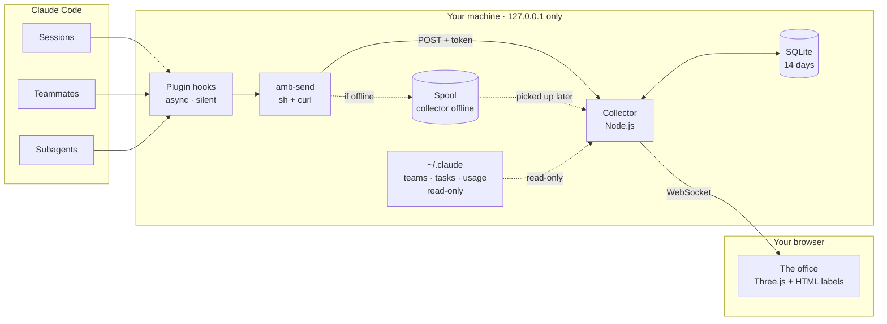

### One event, end to end

What happens in the ~20 ms after Claude Code runs a tool:

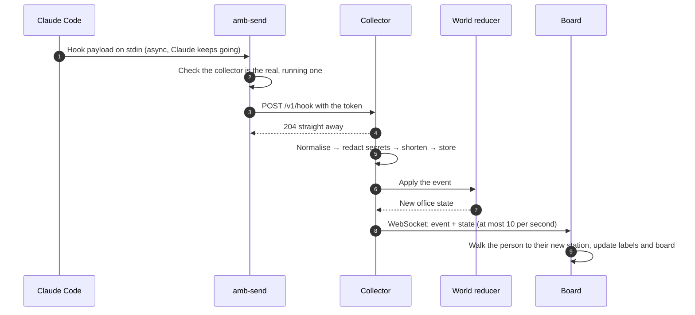

### Inside the collector

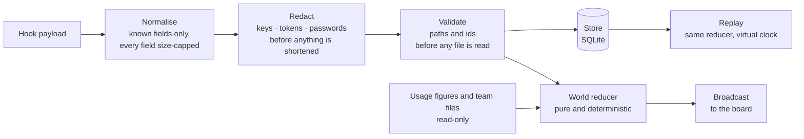

The **world reducer** is a pure function (events in, office state out). Live view, replay and the "while you were away" card all run on it, so they always agree.

### Signing in, without the token ever leaving your machine

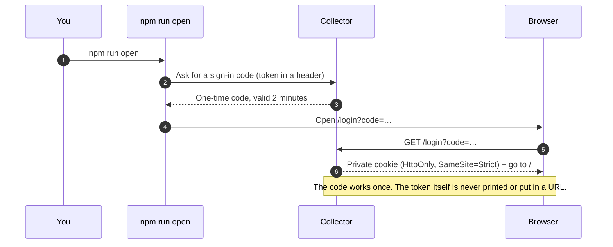

### What `npm run setup` does

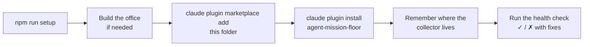

### The packages

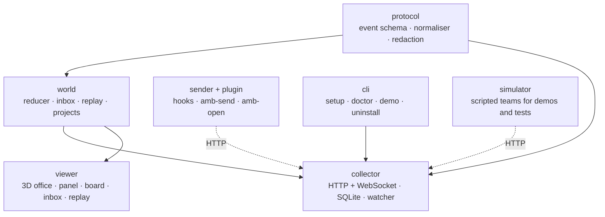

| Layer | Built with |
|---|---|
| Hooks and sender | Claude Code plugin hooks, POSIX `sh`, `curl` (no Node needed) |
| Collector | Node.js 22 (built-in SQLite and TypeScript), `ws` for WebSockets |
| Office | Three.js (WebGPU with WebGL2 fallback), orthographic isometric camera, A* walking paths |
| Labels, panel, board | Plain HTML and CSS over the 3D scene, bundled fonts (Rubik, JetBrains Mono) |
| Build and tests | Vite, strict TypeScript, `node --test` (89 tests), CI on macOS and Linux |

**Performance.**
- **Hooks never slow Claude Code down:** they're async, take about 20 ms and always exit cleanly.
- **The office stays light:**
  - furniture is merged into a few dozen draw calls;
  - shadows redraw only when someone moves;
  - a calm office renders at half rate;
  - on a slow graphics card it switches itself to a lighter quality level.

## Security and privacy by design

AgentMissionFloor sees what your sessions do, so it's built to keep that on your machine and to keep secrets out of it.

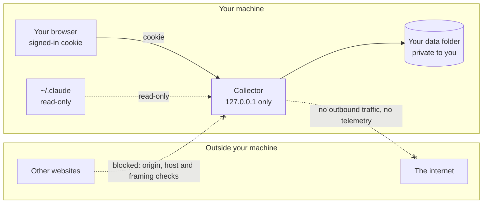

| Layer | How it's protected |
|---|---|
| **Network** | Listens on `127.0.0.1` only. Requests from other websites, other host names (DNS rebinding) and embedding in other pages (clickjacking) are refused. No telemetry, no outbound connections, all assets bundled. |
| **Access** | A random token protects everything except a health check. Browsers sign in with a one-time code that becomes an HttpOnly, SameSite=Strict cookie. The token is never printed, never put in a URL and never accepted from one. Comparisons are timing-safe. |
| **Secrets in your work** | Every event is redacted **before** it's shortened or stored: API keys, tokens, JWTs, private keys, passwords, cookies, connection strings and secret URL parameters (including URL-encoded ones). |
| **What's stored** | File paths and line counts, commands, short prompt summaries and short shell output. **Never** file contents, edit bodies or file reads. Kept for 14 days. |
| **Your files** | `~/.claude` is only ever read. Paths and ids from hook data are validated before any file is opened. The data folder is private to you (`0700`, files `0600`). |
| **Claude Code** | Hooks are async, silent (nothing reaches Claude's context), always exit cleanly, and never hook git worktree events. |
| **The browser page** | A strict Content Security Policy, text rendered as text (never as HTML), and no third-party scripts. |
| **Supply chain** | A small set of dependencies from the official npm registry with integrity hashes. CI pins GitHub Actions to exact commits, runs with read-only permissions and fails on known vulnerabilities. |
| **Your tools** | `stop` and `uninstall` act only on the real collector, and `--purge` deletes only the files the app created. |

**Your data** lives in `~/.agent-mission-floor/`:
- `events.db`: the redacted event history (14 days)
- `token`, `runtime.json`, `sender.*`: local sign-in
- `spool/`: events waiting while the collector was offline (size-capped, deleted once read)

Pause recording with `AMF_DISABLED=1`, or delete everything with `npm run uninstall -- --purge`. To report a vulnerability privately, see [SECURITY.md](SECURITY.md).

## Configuration

All optional, set as environment variables. The original `AMB_*` names still work.

| Variable | Default | What it does |
|---|---|---|
| `AMF_DISABLED` | `0` | `1` pauses sending events (the hooks still exit instantly) |
| `AMF_AUTOSTART` | `1` | `0` stops new sessions from starting the collector |
| `AMF_HOME` | `~/.agent-mission-floor` | Where data, the token and the spool live |
| `AMF_PORT` | last used, or random | Fixes the collector's port |
| `AMF_NO_BROWSER` | `0` | `1`: `npm run open` prints a one-time link instead of opening a browser |
| `AMF_CLAUDE_DIR` | `~/.claude` | Where to look for team and task files (read-only) |
| `AMF_STATIC_DIR` | built viewer | Serve the board from another folder |
| `AMF_COLLECTOR_ENTRY` | found automatically | Which collector the sender auto-starts |

## Performance

- **Hooks never slow Claude Code:** async, ~16 ms, always exit 0.
- **The 3D office stays light:**
  - furniture is merged into a few dozen draw calls
  - shadows only redraw when someone moves
  - a calm office renders at half rate
  - on a slow GPU it switches itself to a lighter quality level
- **Labels use levels of detail and never pile up:** a dot when idle, a one-line pill when working, the full card on hover.

## Troubleshooting

| Problem | Fix |
|---|---|
| *"This board needs its access link…"* or *"sign-in link has expired"* | Run `npm run open` once in this browser |
| Anything else | `npm run doctor` says what's wrong and how to fix it |
| Nobody shows up | Run `npm run setup`, then start a new Claude Code session (or try `npm run demo`) |
| The board is blank or old | `npm run build`, then reload |
| Agents look slow or choppy | Press <kbd>`</kbd>; it drops to the *low* quality level automatically on slow GPUs |

## Project layout

```
packages/
  protocol/   event schema, tool categories, hook normalizer, redaction
  world/      pure reducer: events → office state; inbox; replay; projects
  collector/  ingest, redaction, SQLite, team watcher, conflicts, HTTP + WebSocket
  sender/     amb-send (sh + curl)
  plugin/     Claude Code plugin: async hooks, open command
  viewer/     Three.js office, overlay, inbox, replay (served at /), raw log at /raw/
  simulator/  scripted sessions and teams for demos and tests
  cli/        setup, doctor, open, status, stop, demo, uninstall
.claude-plugin/marketplace.json   lets `claude plugin` install straight from this folder
docs/         PLAN.md, DECISIONS.md (every design decision and why), VISUAL_LANGUAGE.md
SECURITY.md   how it's protected, and how to report a vulnerability
```

**Develop:**

```sh
npm test               # all tests (node --test)
npm run typecheck      # TypeScript, strict
npm run build          # rebuild the office after viewer changes
npm run collector      # run the collector in the foreground
npm run status         # is it running, and who's in the office
```

## Roadmap

- [x] **Phase 0:** data pipeline, redaction, storage, simulator
- [x] **Phase 1:** the 3D office
- [x] **Phase 2:** walking, the mission board, idle life
- [x] **Phase 3:** your inbox, notifications, conflicts, close-up, Follow
- [x] **Phase 4:** replay, footprints, debrief, highlight reel, clip export
- [x] **Security hardening** and **effortless install** (`npm install` + `npm run setup`, doctor, demo, uninstall)
- [x] **Readable board, finished-work marks, grouped team panel, "while you were away", project filter, Focus mode**
- [ ] **Next:** a guided empty state with a demo button, keyboard and screen-reader polish, a daily summary export, optional sounds
- [ ] **Phase 5:** approve or deny straight from the inbox (opt-in), open in editor
- [ ] **Phase 6:** an `npx` launcher, Windows support

## Contributing

Issues and pull requests are welcome. Before opening a PR:

1. Run `npm test` and `npm run typecheck`. Both must pass.
2. Read [`CLAUDE.md`](CLAUDE.md) for the project rules: hooks stay silent and never slow Claude Code down, everything stays local, and text lives in the DOM, not the 3D scene.
3. Log any non-trivial design decision in [`docs/DECISIONS.md`](docs/DECISIONS.md) (context → decision → consequences).

## License

Released under the [MIT License](LICENSE).

```
MIT License

Copyright (c) 2026 Debaditya Chakravorty

Permission is hereby granted, free of charge, to any person obtaining a copy
of this software and associated documentation files (the "Software"), to deal
in the Software without restriction, including without limitation the rights
to use, copy, modify, merge, publish, distribute, sublicense, and/or sell
copies of the Software, and to permit persons to whom the Software is
furnished to do so, subject to the following conditions:

The above copyright notice and this permission notice shall be included in all
copies or substantial portions of the Software.

THE SOFTWARE IS PROVIDED "AS IS", WITHOUT WARRANTY OF ANY KIND, EXPRESS OR
IMPLIED, INCLUDING BUT NOT LIMITED TO THE WARRANTIES OF MERCHANTABILITY,
FITNESS FOR A PARTICULAR PURPOSE AND NONINFRINGEMENT. IN NO EVENT SHALL THE
AUTHORS OR COPYRIGHT HOLDERS BE LIABLE FOR ANY CLAIM, DAMAGES OR OTHER
LIABILITY, WHETHER IN AN ACTION OF CONTRACT, TORT OR OTHERWISE, ARISING FROM,
OUT OF OR IN CONNECTION WITH THE SOFTWARE OR THE USE OR OTHER DEALINGS IN THE
SOFTWARE.
```

*Claude and Claude Code are trademarks of Anthropic. AgentMissionFloor is an independent project and isn't affiliated with or endorsed by Anthropic.*

## Cite

If AgentMissionFloor helps your work, research or teaching, please cite it. GitHub's **"Cite this repository"** button (from [`CITATION.cff`](CITATION.cff)) gives the same entry in other formats.

**BibTeX**

```bibtex
@misc{agentmissionfloor,
  author       = {Chakravorty, Debaditya},
  title        = {{AgentMissionFloor}: A Live {3D} Office for {Claude Code} Agent Sessions},
  year         = {2026},
  publisher    = {GitHub},
  journal      = {GitHub repository},
  howpublished = {\url{https://github.com/debaditc/AgentMissionFloor}},
  note         = {Version 0.1.0}
}
```

**APA**

> Chakravorty, D. (2026). *AgentMissionFloor: A live 3D office for Claude Code agent sessions* (Version 0.1.0) [Computer software]. GitHub. https://github.com/debaditc/AgentMissionFloor

<p align="right"><sub><sup>© Debaditya Chakravorty · Deb</sup></sub></p>
